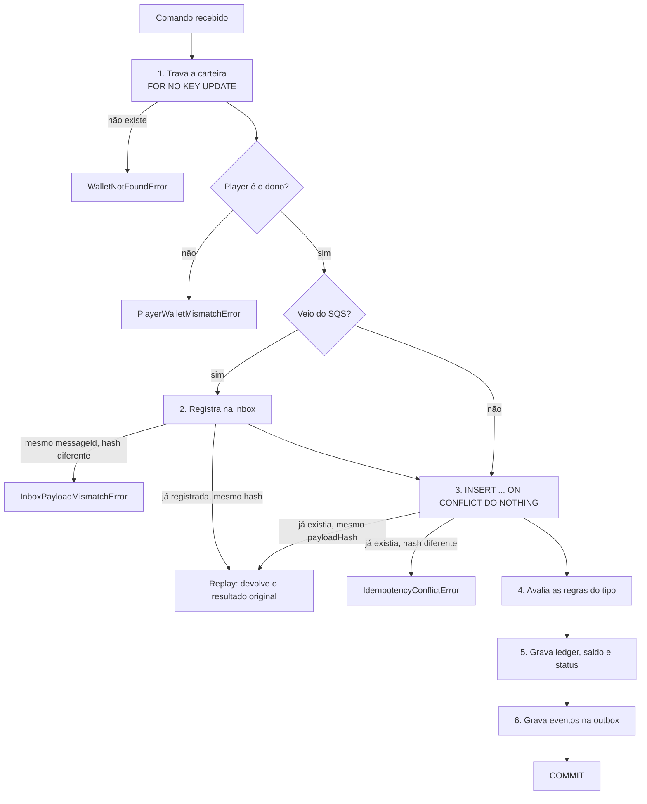
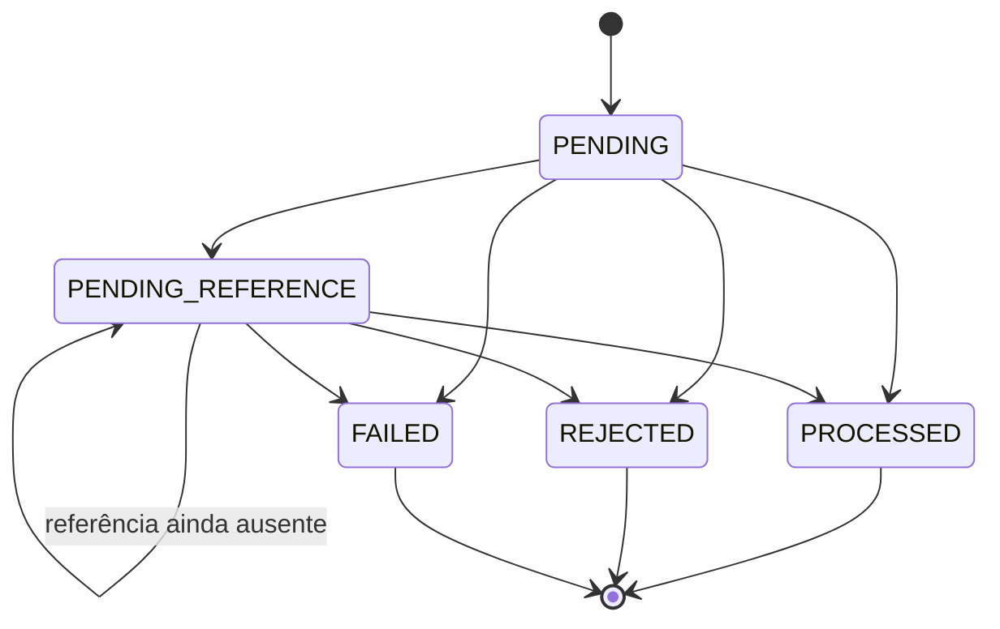

# Arquitetura

Este documento explica **o que o sistema faz, como garante a correção financeira e por que
cada decisão foi tomada**. Para instalar e rodar, veja o [README](./README.md).

**Escopo atual: Fase 3 concluída.** Existem o domínio, o schema, a persistência e o caso de uso
completo (com inbox e outbox gravadas). **Ainda não existem** a API HTTP, o consumer SQS, o
publisher da outbox e os workers (Fases 4 e 5).

## Sumário

1. [Visão geral](#1-visão-geral)
2. [Camadas e fluxo do caso de uso](#2-camadas-e-fluxo-do-caso-de-uso)
3. [Dinheiro](#3-dinheiro)
4. [Garantias no banco de dados](#4-garantias-no-banco-de-dados)
5. [Concorrência: lock da carteira](#5-concorrência-lock-da-carteira)
6. [Idempotência e `payloadHash`](#6-idempotência-e-payloadhash)
7. [Inbox e outbox](#7-inbox-e-outbox)
8. [Regras por tipo de operação](#8-regras-por-tipo-de-operação)
9. [Referência ausente: `PENDING_REFERENCE`](#9-referência-ausente-pending_reference)
10. [Máquina de estados e taxonomia de falhas](#10-máquina-de-estados-e-taxonomia-de-falhas)
11. [Persistência](#11-persistência)
12. [Testes](#12-testes)
13. [Decisões e desvios do plano ou do enunciado](#13-decisões-e-desvios-do-plano-ou-do-enunciado)
14. [Limitações conhecidas](#14-limitações-conhecidas)

---

## 1. Visão geral

O serviço recebe transações de apostas de vários provedores (`BET`, `WIN`, `LOSS`, `REFUND`,
`ROLLBACK`) por HTTP e por SQS, com entrega *at-least-once*. Ele mantém, para cada carteira
(`Wallet`, uma por `playerId` e moeda):

- o **saldo** atual (materializado em `wallets.balance`);
- um **ledger imutável** (`wallet_ledger_entries`) com `balanceBefore` e `balanceAfter` de cada movimento;
- as **transações** recebidas (`wager_transactions`) e seu status;
- a **inbox** (mensagens já processadas) e a **outbox** (eventos a publicar).

Invariantes que nunca podem ser violados:

| Invariante                                                    | Onde é garantido                                  |
| ------------------------------------------------------------- | ------------------------------------------------- |
| Nenhum débito ou crédito duplicado                            | `UNIQUE` por provider + `ON CONFLICT` + hash      |
| Saldo nunca negativo                                          | `CHECK (balance >= 0)` + regra no domínio         |
| Saldo da carteira = último `balance_after` do ledger          | trigger adiada, conferida no `COMMIT`             |
| Ledger imutável                                               | triggers que proíbem `UPDATE`, `DELETE`, `TRUNCATE` |
| Evento confirmado nunca se perde                              | outbox gravada na mesma transação do efeito       |
| Uma referência só é revertida uma vez                         | índice único parcial                              |

## 2. Camadas e fluxo do caso de uso

```
src/
  domain/          regras puras (sem NestJS, ORM ou I/O)
  application/     caso de uso, portas (interfaces), eventos, erros de aplicação
  infrastructure/  SQL, MikroORM, relógio e gerador de ids
  interfaces/      HTTP e consumers (Fases 4 e 5)
```

A dependência aponta para dentro: `infrastructure` e `interfaces` dependem de `application`, que
depende de `domain`. O caso de uso só conhece **portas** (`WalletRepository`, `LedgerRepository`,
`TransactionRunner`, `Clock`, `IdGenerator`…), o que permite testá-lo com PostgreSQL real e relógio
controlado.

### Um caso de uso, uma transação

`ProcessWagerTransactionUseCase` atende HTTP e SQS e processa os cinco tipos de operação em **uma
única transação SQL**. A assinatura é `execute(command, source?)`, onde `source =
{ consumerName, messageId }` só existe quando a origem é uma mensagem SQS.



Qualquer falha em qualquer passo desfaz tudo, inclusive o registro na inbox. A publicação dos
eventos acontece **depois** do commit (Fase 5).

O resultado é `{ transactionId, status, failureCode?, walletBalance, idempotentReplay }`.

## 3. Dinheiro

- `Money` guarda **centavos em `bigint`**. Nenhum valor passa por `number` ou `float`, a aritmética
  é exata e o domínio não depende de biblioteca (o `decimal.js` do plano original não é usado).
- O contrato externo é uma **string decimal**: `{ "amount": "25.00", "currency": "BRL" }`.
- O banco usa `numeric(19,2)`. `Money` limita o valor a esse intervalo e lança `MoneyOverflowError`
  acima dele, para o domínio nunca produzir um número que o banco não aceita.

**Parser estrito (`Money.from`).** Rejeita `number`, `bigint`, `null`, `NaN`, `Infinity`, notação
científica, sinal, vírgula, separador de milhar, zeros à esquerda e mais de 2 casas decimais.
Aceita `"25"`, `"25.5"` e `"25.50"` e normaliza para `"25.00"`. (Para exigir sempre 2 casas na
entrada, troque `{1,2}` por `{2}` no regex.)

A rejeição de mais de 2 casas acontece em `Money.from` porque `numeric(19,2)` **arredondaria em
silêncio**. Do outro lado, o `row-parsers` recusa qualquer `numeric` que chegue do banco como
`number`.

**Guarda contra falha eliminatória.** Testes leem o código-fonte de produção e falham se aparecer
`number`, `parseFloat`, `parseInt`, `Number(`, `Math.` ou `Decimal` no `Money` e nos arquivos do módulo
de transações.

### `Wallet`

- `debit` e `credit` devolvem um `BalanceMovement` (direção, valor, saldo antes e depois, versão). O
  `WalletLedgerEntry` é construído a partir dele, então **saldo e ledger saem do mesmo dado**.
- `version` só incrementa quando o saldo muda. Uma operação rejeitada deixa a carteira intacta.
- `Wallet.open` já começa com o saldo inicial e `version = 1`. A transação `OPENING` e o lançamento
  `CREDIT` com `balanceBefore = 0` são gravados pelo caso de uso, na mesma transação SQL.
- `debit` lança sempre `InsufficientFundsError`; quem escolhe entre `INSUFFICIENT_FUNDS` (aposta) e
  `REVERSAL_WOULD_OVERDRAW` (reversão) é o caso de uso, conforme o tipo.
- O relógio entra por parâmetro (`at`, `now`), o que mantém o domínio puro e os testes determinísticos.

## 4. Garantias no banco de dados

O enunciado exige que unicidade, imutabilidade e não-negatividade valham **no schema**. O schema
é SQL escrito à mão (`src/infrastructure/persistence/schema/initial-schema.sql.ts`).

| Garantia                                                           | Mecanismo                                                   |
| ------------------------------------------------------------------ | ----------------------------------------------------------- |
| Saldo nunca negativo                                               | `CHECK` em `wallets`                                        |
| Uma carteira por `playerId` e moeda                                | `UNIQUE (player_id, currency)`                              |
| Chave de idempotência única **por provider**                       | `UNIQUE (provider_id, idempotency_key)`                     |
| Mesma operação do provedor não se repete                           | `UNIQUE (provider_id, external_transaction_id)`             |
| Ledger imutável                                                    | triggers de `UPDATE`, `DELETE` e `TRUNCATE`                 |
| Um lançamento por transação e por carteira                         | `UNIQUE (transaction_id, wallet_id)`                        |
| Lançamento na moeda e na carteira corretas                         | chaves estrangeiras compostas                               |
| `balanceBefore ± valor = balanceAfter`                             | `CHECK` aritmético                                          |
| Saldo da carteira = `balance_after` do último lançamento           | trigger **adiada**, conferida no `COMMIT`                   |
| Transação `PROCESSED` que move saldo tem seu lançamento            | trigger adiada                                              |
| Reversão aponta para transação `PROCESSED`, do tipo certo, mesmo valor e mesma carteira | trigger adiada                         |
| Uma referência só é revertida uma vez                              | índice único parcial `wager_transactions_reversal_uq`       |
| Transição de status ilegal e estado terminal imutável              | trigger `BEFORE UPDATE`                                     |
| `PENDING_REFERENCE` sempre tem a próxima tentativa agendada        | `CHECK retry_state_valid`                                   |
| Inbox: uma linha por `(consumer_name, message_id)`                 | chave primária composta                                     |

As triggers adiadas rodam no `COMMIT`, com a transação inteira já gravada, e releem o estado
atual das linhas; por isso vários updates na mesma transação continuam corretos.

**Limite desta proteção:** o dono do banco e o superusuário contornam triggers. Em produção, o usuário
da aplicação deve ter `REVOKE UPDATE, DELETE, TRUNCATE` nas tabelas imutáveis.

## 5. Concorrência: lock da carteira

A unidade de concorrência é a `walletId`. Não há lock global.

**Estratégia: lock pessimista por carteira, "lock-first".** Todo escritor trava a carteira com
`SELECT … FOR NO KEY UPDATE` **antes** de ler o saldo e **antes** de inserir a transação. Depois
atualiza com `UPDATE wallets … WHERE version = ?`.

**Por que `FOR NO KEY UPDATE` e não `FOR UPDATE`.** O `FOR UPDATE` conflita com o `FOR KEY SHARE`
que o `INSERT` de uma transação filha (chave estrangeira para `wallets`) toma na linha. O teste de
concorrência provocou um **deadlock real (SQLSTATE 40P01)** com `FOR UPDATE`. O `NO KEY UPDATE` também
serializa escritores, mas não conflita com a FK. É o mesmo modo que o `UPDATE wallets` já usa, pois não
altera colunas de chave.

**Por que travar antes de inserir a transação.** O plano original listava o `INSERT` primeiro; foi
feito o contrário por três motivos:

1. uma carteira inexistente é detectada sem violar a chave estrangeira;
2. a ordem "carteira primeiro" é a mesma em todos os caminhos, então não há deadlock entre eles;
3. duas reversões concorrentes da mesma referência são serializadas: a segunda enxerga a primeira já
   commitada e é rejeitada com `ALREADY_REVERSED`.

O custo é que um replay também espera o lock por um instante.

**Segunda linha de defesa: versão otimista.** A trigger `wallets_guard` exige `version = old + 1` quando
o saldo muda; uma versão defasada falha com `serialization_failure` (40001).

**Ordem do ledger e da outbox.** Ambos usam uma coluna `seq` (`GENERATED ALWAYS AS IDENTITY`) como ordem
estável, porque os relógios das instâncias podem divergir. `seq` só é confiável por carteira com o
lock-first.

**Alternativa descartada: update atômico condicionado** (`UPDATE … SET balance = balance - x WHERE balance >= x`).
É mais simples de ler, mas deixaria a regra de negócio espalhada no SQL.

## 6. Idempotência e `payloadHash`

- A chave de idempotência é **única por provider**, e não global: a chave de um provider nunca colide
  com a de outro.
- O registro usa `INSERT … ON CONFLICT DO NOTHING RETURNING id`. Se a linha já existia, o caso de uso
  busca a existente e compara o `payloadHash`.

| Situação                                            | Resultado                                                   |
| --------------------------------------------------- | ----------------------------------------------------------- |
| Mesma chave e mesmo `payloadHash`                   | **Replay**: devolve o resultado original com `idempotentReplay: true` |
| Mesma chave e `payloadHash` diferente               | `IdempotencyConflictError` (na API, **HTTP 409**)           |
| Mesmo `externalTransactionId`, outra chave, mesmo payload | Replay: é o mesmo fato de negócio                     |

**O que o `payloadHash` cobre:** SHA-256 em hexadecimal sobre o **JSON canônico** (chaves ordenadas em
todos os níveis, sem espaços, `undefined` omitido) dos **campos de negócio**: provider, id externo, player,
carteira, rodada, jogo, tipo, valor, moeda e referência.

**O que fica de fora:** o header `Idempotency-Key`, o instante de criação e os metadados de transporte
(como o `messageId` do SQS). O valor passa por `Money`, então `"25"` e `"25.00"` geram o mesmo hash. O
`create` calcula o hash sozinho, então ele nunca fica inconsistente com os campos.

## 7. Inbox e outbox

### Inbox (entrada via SQS)

- A deduplicação por `(consumerName, messageId)` fica **na mesma transação do efeito**, logo depois do
  lock da carteira. A linha só fica visível se o efeito foi commitado; por isso "já registrada" significa
  "já processada".
- O `payload_hash` guardado é o hash de negócio da transação. Duas entregas do mesmo `messageId` com o
  mesmo hash são replay; com hash diferente, `InboxPayloadMismatchError`.
- Entregas simultâneas da mesma mensagem esperam o commit da primeira (índice único) e então veem
  "já registrada".
- Uma transação `REJECTED` também consome a mensagem (a regra de negócio é determinística: reentregar
  não muda o resultado).
- Se a outbox falha ou há erro que aborta a transação, a inbox é desfeita junto, e a reentrega funciona.
- Na entrada HTTP não há inbox (não se passa `source`).
- **Erros permanentes** (`IdempotencyConflictError`, `InboxPayloadMismatchError`) devem ir para a DLQ:
  reprocessar não adianta.

### Outbox (saída de eventos)

Os eventos são gravados na tabela `outbox_messages` **na mesma transação** do saldo e do ledger: ou os
dois acontecem, ou nenhum. O publisher (Fase 5) lê depois do commit.

Eventos:

| Evento                              | Quando                                                              |
| ----------------------------------- | ------------------------------------------------------------------- |
| `WagerTransactionProcessed`         | transação aplicada (inclui `LOSS`)                                  |
| `WagerTransactionRejected`          | rejeição de negócio                                                 |
| `WagerTransactionPendingReference`  | a primeira vez que a transação passa a aguardar a referência        |
| `WalletBalanceChanged`              | só quando o saldo muda (não é emitido em `LOSS`)                    |

Envelope versionado: `{ eventId, eventType, version: 1, aggregateId, occurredAt, data }`. O agregado
(`aggregateId`) é a **carteira**, e o dinheiro viaja como string decimal.

## 8. Regras por tipo de operação

| Tipo       | Efeito no saldo | Referência                         | Observações                                                              |
| ---------- | --------------- | ---------------------------------- | ------------------------------------------------------------------------ |
| `BET`      | debita          | proibida                           | sem saldo: `REJECTED` / `INSUFFICIENT_FUNDS`                             |
| `WIN`      | credita         | opcional (uma `BET`)               | o valor **não** precisa ser igual ao da `BET`                            |
| `LOSS`     | nenhum          | opcional (uma `BET`)               | sem lançamento no ledger; aceita valor `0.00`; emite `Processed`         |
| `REFUND`   | credita         | obrigatória (uma `BET`)            | valor igual ao da referência                                             |
| `ROLLBACK` | inverte a referência | obrigatória (`BET`, `WIN` ou `REFUND`) | valor igual; reverter uma `BET` credita, reverter um `WIN` ou um `REFUND` debita |
| `OPENING`  | credita         | proibida                           | **interno**: criado pela abertura da carteira, rejeitado em `create`     |

Valor zero só é aceito em `LOSS`. Essa é uma interpretação do projeto: um `WIN` de zero iria contra a
regra da carteira de só movimentar valores positivos.

### Resolução da referência

A busca é por `(providerId, referenceExternalTransactionId)`. Para reversões, `checkReference`
devolve o `FailureCode` da **primeira** violação, nesta ordem:

1. `REFERENCE_MISMATCH`: provider, player, carteira, rodada ou moeda diferentes;
2. `INVALID_REFERENCE_KIND`: `REFUND` que não aponta para `BET`, ou `ROLLBACK` fora de `BET`/`WIN`/`REFUND`;
3. `AMOUNT_MISMATCH`: valor diferente do original (não há reversão parcial).

Esse passo não olha o status da referência nem se ela já foi revertida, porque isso depende de estado
persistido. O caso de uso confere depois:

- a referência precisa estar `PROCESSED`; se foi `REJECTED` ou `FAILED`, a reversão é rejeitada com
  `REFERENCE_NOT_PROCESSED` (não há o que reverter);
- se a referência já foi revertida, `ALREADY_REVERSED`;
- se aplicar a reversão deixaria o saldo negativo, `REVERSAL_WOULD_OVERDRAW`.

**Uma reversão por referência.** O README do desafio fala em reverter "uma vez" por tipo. Aqui a regra
é mais estrita: cada referência admite **uma única reversão, por `REFUND` ou por `ROLLBACK`**, garantida
por um índice único parcial no banco. (`WIN` pode referenciar a mesma `BET` várias vezes e fica fora do índice.)

## 9. Referência ausente: `PENDING_REFERENCE`

Se uma reversão chega **antes** da transação que ela referencia:

1. a transação fica `PENDING_REFERENCE` com `nextAttemptAt` agendado e emite
   `WagerTransactionPendingReference` **uma única vez**;
2. um worker (Fase 5) a reprocessa quando `nextAttemptAt` vence, chamando
   `retryPendingReference(transactionId)`;
3. esgotadas as tentativas, ela vira `REJECTED` com `REFERENCE_NOT_FOUND`.

**Política padrão** (injetável via `PendingReferencePolicy`): **5 buscas** com backoff exponencial a partir
de **1 s**. As esperas são 1, 2, 4 e 8 s; a 5ª falha rejeita. Se na última tentativa a referência existe
mas ainda está pendente, o resultado é `REFERENCE_NOT_PROCESSED`.

- `retryPendingReference` é idempotente: ignora o que não venceu ou já foi resolvido.
- O reprocessamento usa **o mesmo `evaluate`** da chegada nova, então as regras não divergem.
- **Cadeias funcionam:** um `ROLLBACK` de um `REFUND` pendente espera pelo `REFUND`.
- `PENDING_REFERENCE` exige `next_attempt_at` preenchido (senão a linha nunca seria reprocessada).
- Para o worker, há o índice parcial `wager_transactions_pending_reference_due_idx`, pensado para varrer
  as vencidas com `FOR UPDATE SKIP LOCKED`.

## 10. Máquina de estados e taxonomia de falhas



`PROCESSED`, `REJECTED` e `FAILED` são **terminais**: qualquer transição a partir deles lança
`InvalidTransactionStateError` e o estado fica intacto (o teste percorre as 25 combinações). O banco
repete a proteção por trigger. `PENDING` é o estado inicial, dentro da transação SQL.

`reject()` só aceita códigos de negócio e `fail()` só aceita o código de infraestrutura, para o status
nunca contradizer o código.

### `REJECTED` × `FAILED`

- **`REJECTED`**: violação de regra de negócio. É resultado esperado e determinístico.
- **`FAILED`**: erro permanente de infraestrutura. Fica registrado para auditoria e nunca vira `REJECTED`.

### `failureCode`

| Código                             | Status     | Quando ocorre                                                                       |
| ---------------------------------- | ---------- | ----------------------------------------------------------------------------------- |
| `INSUFFICIENT_FUNDS`               | `REJECTED` | `BET` sem saldo                                                                     |
| `REVERSAL_WOULD_OVERDRAW`          | `REJECTED` | `REFUND`/`ROLLBACK` deixaria o saldo negativo                                       |
| `REFERENCE_NOT_FOUND`              | `REJECTED` | a referência não chegou dentro do limite de tentativas                              |
| `REFERENCE_NOT_PROCESSED`          | `REJECTED` | a referência existe, mas foi rejeitada, falhou ou ainda está pendente               |
| `REFERENCE_MISMATCH`               | `REJECTED` | referência de outro provider, player, carteira, moeda ou rodada                     |
| `INVALID_REFERENCE_KIND`           | `REJECTED` | `REFUND` que não aponta para `BET`, ou `ROLLBACK` fora de `BET`/`WIN`/`REFUND`      |
| `AMOUNT_MISMATCH`                  | `REJECTED` | valor da reversão diferente do original                                             |
| `ALREADY_REVERSED`                 | `REJECTED` | a referência já foi revertida (por `REFUND` ou `ROLLBACK`)                          |
| `CURRENCY_MISMATCH`                | `REJECTED` | moeda da operação diferente da moeda da carteira                                    |
| `PERMANENT_INFRASTRUCTURE_ERROR`   | `FAILED`   | erro permanente de infraestrutura                                                   |

Um `playerId` que não é o dono da carteira lança `PlayerWalletMismatchError` e **não persiste nada**;
não existe `failureCode` para isso.

## 11. Persistência

- **Repositórios em SQL puro via `em.execute`, sem entities do MikroORM.** Os motivos: `seq` é
  `GENERATED ALWAYS`, há triggers adiadas, `ON CONFLICT` e `SKIP LOCKED`, e o unit-of-work do ORM
  reordenaria as escritas. O MikroORM é usado para configuração, migrations e transações.
- **Fronteira de transação:** as portas `TransactionRunner` e `DbSession` deixam o **caso de uso** definir
  a transação; os repositórios sempre recebem a sessão.
- **Migrations escritas à mão em SQL** (`--blank`, nunca o diff), porque as constraints e triggers não
  são geradas pelo MikroORM. O registro é por `migrationsList`, com `up` e `down`.
- **Runtime:** a aplicação roda com Bun (`bun src/main.ts`, como faz o Dockerfile). Com `moduleResolution:
  bundler`, a saída do `nest build` tem imports sem extensão e não roda no Node puro; evite
  `node dist/main.js`.

## 12. Testes

Os testes de integração rodam contra **PostgreSQL real, sem mock de banco**. Cada suíte cria um banco
isolado e o apaga no fim. O relógio é injetável (`FakeClock`), então o backoff é testado sem esperar.
Todo teste de escrita termina conferindo que o saldo da carteira é igual ao ledger.

Principais cenários de concorrência (todos com paralelismo real):

| Cenário                                                                   | Resultado esperado                               |
| ------------------------------------------------------------------------- | ------------------------------------------------ |
| **Cenário obrigatório:** saldo 100,00 e duas apostas simultâneas de 80,00 | uma `PROCESSED`, uma `REJECTED`, saldo 20,00, um único débito |
| 30 envios simultâneos da **mesma** aposta                                 | um débito e 29 replays                           |
| 60 apostas distintas em saldo de 25,00                                    | saldo nunca negativo e carteira = ledger         |
| Carteiras diferentes em paralelo                                          | não se bloqueiam (lock por `walletId`)           |
| 15 `REFUND`s simultâneos da mesma aposta                                  | um único crédito                                 |
| 20 entregas simultâneas do mesmo `WIN`                                    | um único efeito                                  |
| 20 entregas simultâneas da mesma mensagem SQS                             | um efeito e uma linha na inbox                   |
| 25 `BET`s, 25 `WIN`s e 10 `LOSS`s embaralhados em saldo de 10,00          | saldo exato em centavos e carteira = ledger      |
| Falha ao gravar a outbox                                                  | tudo desfeito (efeito, inbox e evento juntos)    |

**Mutações:** após cada funcionalidade, a garantia foi removida de propósito (o lock, a checagem de
payload, a de reversão já aplicada, o backoff exponencial, o esgotamento das tentativas, a releitura sob
lock, a inbox, a checagem de payload da inbox) e ao menos um teste passou a falhar.

## 13. Decisões e desvios do plano ou do enunciado

| Decisão                                              | Motivo e consequência                                                                 |
| ---------------------------------------------------- | ------------------------------------------------------------------------------------- |
| `bigint` em vez de `decimal.js`                      | aritmética exata sem dependência; o contrato continua sendo string decimal            |
| Lock da carteira **antes** de inserir a transação    | ver [seção 5](#5-concorrência-lock-da-carteira)                                       |
| `FOR NO KEY UPDATE` em vez de `FOR UPDATE`           | evita o deadlock 40P01 comprovado em teste                                            |
| Chave de idempotência **por provider**               | o plano dizia `UNIQUE(idempotency_key)` global; por provider evita colisão e vazamento entre provedores |
| Uma reversão por referência (`REFUND` **ou** `ROLLBACK`) | mais estrito que o "mesmo tipo" do README; documentado e garantido por índice único parcial |
| `WIN` com valor livre; zero só em `LOSS`             | só reversões exigem valor igual; `WIN` de zero violaria a regra da carteira           |
| Sem entities do MikroORM; migrations em SQL          | recursos do banco que o ORM não modela bem                                            |
| `PlayerWalletMismatchError` sem `failureCode`        | é erro de contrato do chamador, não resultado de negócio persistido                   |
| Conflito de idempotência = **HTTP 409**              | o payload é válido; o conflito depende do estado já gravado (decisão do autor)        |
| 5 tentativas com backoff exponencial de 1 s          | escolha do autor para a espera de referências (política injetável)                    |

## 14. Limitações conhecidas

- **Replay devolve o saldo atual.** `walletBalance` no resultado é o saldo da carteira lido com ela
  travada: no replay de uma `BET` antiga, é o saldo de agora, **não o da época**. Uma correção possível é
  gravar o saldo na própria transação ao torná-la terminal.
- **Janela de espera curta.** A janela de 15 s (1 + 2 + 4 + 8) é curta para produção. A política é
  injetável.
- **Sem jitter.** Muitos pendentes alinham seus retries.
- **Retry por polling.** Quem espera uma referência não é acordado quando ela chega; o worker (Fase 5)
  varre as pendentes vencidas.
- **Overflow de saldo.** Erros inesperados de overflow propagam como exceção.
- **Triggers e privilégios.** Dono e superusuário do banco contornam as triggers; falta o usuário de
  aplicação restrito (ver [seção 4](#4-garantias-no-banco-de-dados)).
- **Fora do escopo atual:** API HTTP, consumer SQS, publisher da outbox, worker de pendentes,
  observabilidade e autenticação.
